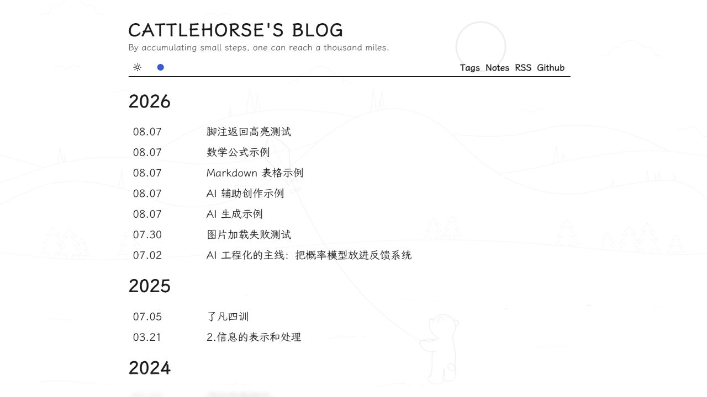
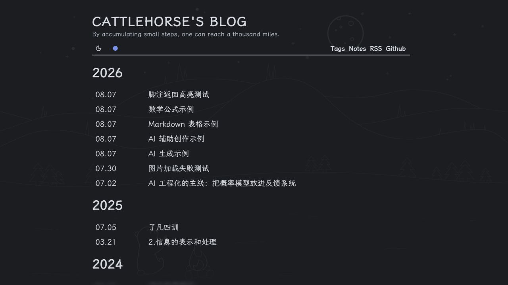

# YinYang

一个极简的 Hugo 博客主题，fork 自 [joway/hugo-theme-yinyang](https://github.com/joway/hugo-theme-yinyang)，并在此基础上做了大量增强。

**在线演示**：[https://cattle0horse.github.io/](https://cattle0horse.github.io/)





## 与原版 yinyang 相比

除了继承原版的极简布局，这个 fork 新增了以下能力：

| 功能 | 说明 |
|---|---|
| 🌓 外观切换 | 靛蓝 / 紫罗兰 / 石墨调色盘与明暗模式独立选择，点击轮换亮色 / 暗色 / 跟随浏览器，无闪屏（FOUC） |
| 📐 数学公式 | 构建期服务端渲染 KaTeX，页面加载零 JS、零跳变 |
| 💻 代码块工具栏 | 语言标签、一键复制、超长代码自动折叠 |
| 🖼 图片增强 | 原生懒加载、异步解码、骨架屏占位、加载失败重试 |
| 📑 文章目录 | 宽屏侧边栏 / 窄屏浮层，滚动自动高亮当前位置 |
| 📌 脚注跳转 | 点击跳转脚注，返回引用处并脉冲高亮 |
| 🗂 Gallery 图库 | 专门的内容类型，两列网格展示图片 |
| ⚡ 文章操作区 | 复制 Markdown、查看 Raw、编辑原文纠错 |
| 🤖 AI 创作标注 | frontmatter 声明创作方式，标题下方低调标注 |
| 📝 Notes 短记录 | 无标题正文时间线、独立链接、来源文章与分页 |

## 安装

在站点根目录执行：

```shell
git submodule add https://github.com/Cattle0Horse/hugo-theme-yinyang.git themes/yinyang
```

修改 `config.toml`：

```toml
theme = "yinyang"
```

## 本地预览

在仓库根目录启动示例站点：

```shell
hugo server -s exampleSite --themesDir ../.. --theme $(basename $(pwd))
```

浏览器打开 `http://localhost:1313` 即可预览主题效果。

## 配置

### 标题

```toml
[params]
headTitle = "CattleHorse"
```

如果不设置 `headTitle`，则使用 `.Site.Params.author.name`。

### 主要内容分区

```toml
[params]
mainSections = ["posts"]
```

`mainSections` 只控制 Blog 首页，Notes 固定从 `content/notes/` 读取并显示在 `/notes/`。

### Notes 标签

Notes 使用独立的 `note_tags` taxonomy，不会进入 Blog 的 `tags`。站点必须保留 Hugo 默认 taxonomy，并同时注册 `note_tags`：

```toml
[taxonomies]
category = "categories"
tag = "tags"
note_tag = "note_tags"

[permalinks.taxonomy]
note_tags = "/notes/tags/"

[permalinks.term]
note_tags = "/notes/tags/:slug/"
```

Blog 标签继续使用 `tags`，链接到 `/tags/<tag>/`；Note 标签写在 `note_tags`，链接到 `/notes/tags/<tag>/`。两个 taxonomy 即使使用相同名称的标签，也会分别统计和展示。

### 配色与明暗模式

主题内置靛蓝（`indigo`）、紫罗兰（`violet`）和石墨（`graphite`）三套配色，共用中性背景，每套均支持亮色与暗色。页头的色点按钮展开紧凑色点调色盘，浅色底与细边框标记当前配色。明暗按钮点击轮换「亮色 → 暗色 → 跟随浏览器」，默认跟随浏览器并实时响应其偏好变化。手动选择会保存在浏览器中，重新选择「跟随浏览器」会清除手动明暗偏好。

```toml
[params.colorScheme]
default = "indigo"
available = ["indigo", "violet", "graphite"]
allowUserChoice = true
```

- `default`：首次访问时使用的配色；未配置或不在 `available` 中时，使用第一套有效配色。
- `available`：站点允许的配色；目前支持 `indigo`、`violet`、`graphite`，无效值会被忽略。
- `allowUserChoice`：至少有两套可用配色时，在页头显示调色盘按钮。

不配置 `[params.colorScheme]` 时使用靛蓝配色且不显示调色盘。明暗选择按钮始终保留。旧配色配置或浏览器保存的旧配色值会回退到有效默认配色。

### RSS

主题将 Blog 和 Notes 分成两个 feed：Blog 使用 `/index.xml`，且只包含 `mainSections` 中的内容；Notes 使用 `/notes/index.xml`。tags 和 categories 的总览页及条目页均不生成 RSS。

Hugo 的 `outputs` 决定文件是否真正生成。以下配置同时开启 Blog RSS 和 Notes RSS：

```toml
[outputs]
home = ["HTML", "RSS"]
section = ["HTML"]
taxonomy = ["HTML"]
term = ["HTML"]

[[cascade]]
outputs = ["HTML", "RSS"]

[cascade.target]
kind = "section"
path = "/notes"
```

- 禁用 Blog RSS：将 `home` 改为 `["HTML"]`。
- 禁用 Notes RSS：删除上述 `[[cascade]]` 配置，或将其 `outputs` 改为 `["HTML"]`。
- 不要给全局 `section` 加入 `"RSS"`，否则 Gallery 等其他 Section 也会生成 feed。

### Notes 短记录

Notes 用于直接留下不要求完整的短记录。每条 Note 是独立页面，按月份目录和月内三位序号组织：

```text
content/notes/
└── 2026-08/
    ├── 001.md
    └── 002.md
```

最小内容只有日期和正文；`title`、`note_tags`、`source` 都是可选字段：

```yaml
---
date: 2026-08-31T14:19:47+08:00
draft: false
# title: ""
# note_tags: []
# source: []
---

一句话也算写作。先留下，再回头。
```

- 未设置 `title` 时，页面保持无标题；浏览器标题和 SEO 使用正文前 60 个字符，空正文回退到日期时间。
- `source` 是来源列表，每项可以是普通文字、URL 或 `[标题](URL)`。Markdown 链接显示指定标题，裸 URL 只显示域名，普通文字直接显示；列表和详情页会在正文前显示来源。
- `/notes/` 每页显示 30 条，完整正文直接在时间线中展开；每条记录仍有独立固定链接。
- `/notes/tags/<tag>/` 只显示拥有对应 `note_tags` 的 Note，并复用 `/notes/` 的时间线、按月分组和分页样式。
- Note 详情页使用独立的 Notes 标签，并复用复制 Markdown、编辑原文、查看 Raw 和底部纠错入口。
- Notes 不进入 Blog RSS；启用 Notes RSS 时，只进入独立的 `/notes/index.xml`。

主题的 `archetypes/notes.md` 提供上述 front matter。示例站根目录还包含无参数创建脚本；在示例站中使用：

```powershell
cd exampleSite
nu note.nu
```

脚本会找到当前月份的最大三位序号，创建下一条 Note 并通过 VS Code 打开。实际内容站点使用时，将 `exampleSite/note.nu` 复制到站点根目录后运行同一命令。脚本只负责创建，不执行构建、提交或发布。

### 快速新建 Blog

Blog 使用独立 Page Bundle，便于把正文、图片和附件放在同一目录。示例站中运行：

```powershell
cd exampleSite
nu blog.nu
```

脚本会创建 `content/posts/YYYY-MM-DD-HHMMSS/index.md` 并通过 VS Code 打开。新文章默认 `draft: true`，必须填写标题并在完成后手动改为 `false`。实际内容站点使用时，将 `exampleSite/blog.nu` 复制到站点根目录；发布仍由独立流程负责。

Blog archetype 会把所有主题支持的页面级 front matter 作为注释提供，需要时直接取消注释：

```yaml
---
title: ""
date: 2026-08-31T16:30:00+08:00
draft: true
# summary: ""
# description: ""
# tags: []
# categories: []
# ai: none # none | assisted | generated
# toc: true # false disables the table of contents
# album: [] # Open Graph image URLs
---
```

### 字体

本主题使用**系统字体栈**——无需 CDN、无需下载、无 FOFT。浏览器自动为每个平台选择最佳字体：

| 用途 | 字体栈 |
|---|---|
| 正文 | `-apple-system, BlinkMacSystemFont, "Segoe UI", Roboto, "Noto Sans", ...` |
| 代码 | `"SF Mono", "Fira Code", Menlo, Monaco, "Courier New", ...` |

如需使用自定义字体，通过 `extraHead` 注入 CDN 并覆盖优先级。以下以霞鹜文楷（正文）+
Fira Code（代码）为例：

```toml
[params]
extraHead = '''
  <link rel="stylesheet" href="https://cdn.jsdelivr.net/npm/@callmebill/lxgw-wenkai-web@latest/lxgwwenkai-regular/result.css" />
  <link rel="stylesheet" href="https://cdn.jsdelivr.net/npm/firacode@6.2.0/distr/fira_code.min.css" />
  <style>
    body { font-family: "LXGW WenKai", sans-serif; }
    pre, code { font-family: "Fira Code", "SF Mono", Menlo, monospace; }
  </style>
'''
```

或者使用 `extraCSSFiles` 加载自己的样式表：

```toml
[params]
extraCSSFiles = ["css/fonts.css"]
```

### 页脚链接

```toml
[[params.socials]]
name = "About Me"
link = "https://cattle0horse.github.io"
[[params.socials]]
name = "Github"
link = "https://github.com/cattle0horse"
```

### 自定义 Head

```toml
[params]
extraHead = '<script src="xxxx.js"></script>'
```

### 自定义 CSS

```toml
[params]
extraCSSFiles = ["css/foo.css", "css/bar.css"]
```

### 访问统计

不蒜子统计在未配置时关闭。启用后，所有页面都会采集全站 UV/PV，但暂不展示；Blog、Gallery、Note 详情页的标题下显示本页阅读量，Notes 时间线不为每条 Note 单独计数。示例站已启用。

```toml
[params.busuanzi]
enabled = true
```

启用后，浏览器会从 `busuanzi.ibruce.info` 加载脚本并向其发送统计请求；本地预览的访问也可能进入统计。计数由第三方服务提供，脚本被拦截或服务不可用时数字不会显示。

### 数学公式

本主题在构建期将 `$...$` / `$$...$$` 渲染为 KaTeX HTML，页面加载时**无需加载任何 JS**、公式不会跳动。使用前需启用 Goldmark 的 passthrough 扩展：

```toml
[markup]
[markup.goldmark.extensions]
[markup.goldmark.extensions.passthrough]
enable = true
delimiters = { block = ["$$", "$$"], inline = ["$", "$"] }
```

在正文中直接书写 LaTeX 即可：

```markdown
行内公式 $E = mc^2$

块级公式：
$$
\int_{-\infty}^{\infty} e^{-x^2} dx = \sqrt{\pi}
$$
```

书写注意：块级公式内的 `=` / `-` 等标记**不能单独成行**（会被 markdown 解析为 setext 标题打断公式），裸 `<` / `>` 请用 `\lt` / `\gt`。

### 代码块

代码块自动获得语言标签、复制按钮，超过 `codeMaxLines`（默认 15）行的代码块自动折叠：

```toml
[params]
codeMaxLines = 15
```

### 图片、文章操作与目录

`[params.image]` 控制图片增强，`enabled` 为总开关，`lazy` 启用原生懒加载，`loading` 额外启用加载占位和失败重试：

```toml
[params.image]
enabled = true
lazy = true
loading = true
```

`loading` 启用时，骨架屏图片使用 `decoding="async"` 异步解码：图片字节到位即触发 `load`，解码移出主线程、不再阻塞页面交互；上屏前经 `img.decode()` 协调，保证像素可绘制后立刻淡入（200ms opacity + scale 合成器动画，`prefers-reduced-motion` 下禁用过渡），骨架屏不占用多余等待时间。

`tableOfContents` 启用文章目录。文章 frontmatter 使用 `toc: false` 可单篇禁用目录，旧配置中的 `notoc: true` 也保持兼容。

文章操作区（标题下方按钮）由 `[params.actions]` 控制：`enabled` 为总开关，`copyMarkdown` 启用"复制 Markdown"按钮，嵌套 `editPage` 启用编辑原文 / 查看 Raw 按钮和底部纠错链接，`branch` 默认值为 `main`，`text` 可覆盖链接文案：

```toml
[params.actions]
enabled = true
copyMarkdown = true

[params.actions.editPage]
enabled = true
repo = "https://github.com/Cattle0Horse/Cattle0Horse.github.io"
branch = "main"
text = "有错误？欢迎提交 Pull Request"
```

`extraHead`、`extraBody` 和 `postContent.header`、`postContent.footer` 会按原样通过 `safeHTML` 注入，仅应填入可信内容。`extraCSSFiles` 则按路径生成样式链接。

### AI 创作标注

文章 front matter 使用 `ai` 声明创作方式，会在文章标题下方的元信息区显示一个低调的标注行（SVG 图标 + 弱色小字）：

| `ai` 值 | 含义 | 标题下方显示 |
|---|---|---|
| `none` | 纯人创作（默认，缺省等同此值） | 不显示 |
| `assisted` | AI 辅助创作 | `AI 辅助创作` |
| `generated` | AI 生成，经人工编辑 | `AI 生成 · 经人工编辑` |

`ai` 缺省、为 `none` 或其他未知值时，标注行均不显示。

标注行为可通过站点配置 `[params.aiLabel]` 控制：`enabled` 为总开关（缺省开启，`false` 时即使文章声明 `ai` 也不渲染），`assisted` / `generated` 可自定义文案（缺省回退上表默认文案）：

```toml
[params.aiLabel]
enabled = true
assisted = "由 AI 协助撰写"
generated = "由 AI 生成，经人工校对"
```

### Gallery 图库

`gallery` 是一个专门渲染图片网格的内容类型。在 `content/gallery/` 目录下创建文章，front matter 声明 `gallery` 数组即可，无需正文：

```toml
---
title: "相册示例"
date: 2026-08-04
gallery:
  - url: "/images/little-bear-light.png"
    name: "白日小熊"
  - url: "https://example.com/photo.jpg"
    name: "远程图片"
---
```

每张图片由共享的 `image-tag.html` 渲染，自动获得与正文图片一致的懒加载、骨架屏和失败重试能力（受 `[params.image]` 的 `lazy` / `loading` 控制），并以两列网格布局展示，`name` 显示为图片下方的说明文字。

> 注意：`gallery` 不属于 `mainSections`（默认 `["posts"]`），因此不会出现在首页或 `/gallery/` 列表页，需通过文章 URL 直接访问。可参考 `exampleSite/content/gallery/sample.md`。

### 文章首尾插入内容

`[params.postContent]` 控制文章正文前后的注入内容，`enabled` 为总开关，`header` / `footer` 按原样通过 `safeHTML` 注入：

```toml
[params.postContent]
enabled = true
header = ""
footer = ""
```

## 示例

```toml
# ---------- 站点 ----------
baseURL = "https://cattle0horse.github.io"
locale = "zh-cn"
theme = "yinyang"
title = "CattleHorse's Blog"

# ---------- URL ----------
[permalinks]
posts = "/blog/:title/"

[permalinks.taxonomy]
note_tags = "/notes/tags/"

[permalinks.term]
note_tags = "/notes/tags/:slug/"

# ---------- Taxonomy ----------
[taxonomies]
category = "categories"
tag = "tags"
note_tag = "note_tags"

# ---------- RSS ----------
[outputs]
home = ["HTML", "RSS"]
section = ["HTML"]
taxonomy = ["HTML"]
term = ["HTML"]

[[cascade]]
outputs = ["HTML", "RSS"]

[cascade.target]
kind = "section"
path = "/notes"

# ---------- Markdown / 代码高亮 ----------
[markup]
[markup.goldmark]
[markup.goldmark.renderer]
unsafe = true
[markup.highlight]
guessSyntax = true
noClasses = false
style = "tango"
tabWidth = 2

# ---------- 主题参数 ----------
[params]
description = "By accumulating small steps, one can reach a thousand miles."
extraHead = ''
favicon = "/logo.png"
headTitle = "CattleHorse's Blog"
mainSections = ["posts"]
staticPrefix = "https://cdn.jsdelivr.net/gh/cattle0horse/blog"

[params.colorScheme]
default = "indigo"
available = ["indigo", "violet", "graphite"]
allowUserChoice = true

[params.image]
enabled = true
lazy = true
loading = true

# ---------- 作者 ----------
[params.author]
homepage = "https://github.com/cattle0horse"
name = "CattleHorse"

# ---------- 社交链接 ----------
[[params.socials]]
name = "Notes"
link = "/notes/"
[[params.socials]]
name = "RSS"
link = "/index.xml"
[[params.socials]]
name = "Github"
link = "https://github.com/cattle0horse"
```
